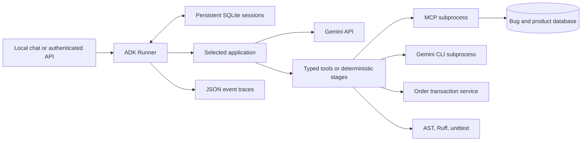

# Architecture and code walkthrough

## Shared runtime

`assignment/runtime.py` loads one of five allowlisted applications, creates an ADK Runner, limits model calls and execution time, and saves events. `assignment/sessions.py` implements ADK's BaseSessionService using Python's SQLite library. Sessions are keyed by application, user and session ID; revision checks reject stale writes. Temporary ADK state is not persisted. This implementation uses only session-scoped state and is designed for one application instance.

`assignment/api.py` authenticates requests with a bearer secret, assigns the operator identity, validates request bodies, serializes agent runs, and logs request IDs and durations without recording prompts in server logs. `/confirm` only accepts a pending confirmation belonging to the authenticated session. `/shop` endpoints also allow deterministic API demonstrations without Gemini.

`assignment/config.py` loads `.env` without overriding existing environment variables. Model, data directory and artifact directory are configurable. The project registry deliberately exposes only `buggy` and `fixed` samples.

## A: Research

`agents/assignment_a_lead_generation/assignment_a_lead_generation.py` defines an interactive coordinator with AgentTool wrappers. Pattern discovery uses Google Search to propose a profile; the coordinator asks for confirmation. The research workflow is a SequentialAgent containing company research, independent verification, schema-constrained synthesis, and deterministic export.

Each search agent owns the built-in search tool separately. Results pass through ADK state keys `candidate_research`, `verified_research`, and `lead_report`. `assignment/reports.py` validates HTTP source links, deduplicates domains, and escapes spreadsheet formula prefixes in CSV exports. URL validation does not prove factual accuracy: reviewers still need to inspect source evidence. The score rubric is explicit but the model's assessment remains an inference.

## B: CLI tool pipeline

`agents/assignment_b_gemini_cli/assignment_b_gemini_cli.py` passes a plan to an executor that invokes `assignment/gemini_cli.py`. The wrapper discovers the installed package's actual executable entry point, supplies an explicit sample source bundle over stdin, uses an argument array with `shell=False`, isolates CLI settings in a temporary home, and blocks CLI tools through `config/cli-policy.toml`.

The CLI runs for analysis only. It cannot edit the repository through this wrapper. Exit status, elapsed time, bounded output, and JSON parsing failures are returned to the pipeline. Missing credentials produce an explicit unavailable result. This demonstrates a real CLI process inside ADK, not an SDK call labeled as CLI.

## C: MCP bug assistant

`assignment/mcp_server.py bugs` exposes `search_bugs`, `get_bug`, and `read_source` over MCP stdio. `assignment/mcp_client.py` creates ADK McpToolset connections with an explicit tool filter. `assignment/bugs.py` uses parameterized database queries and a file allowlist.

The agent searches tickets, reads code, and cites ticket IDs and line numbers. BUG-101, BUG-102 and BUG-103 have deliberately reproducible defects in the sample. Tools are read-only; diagnosis does not automatically change issues or files.

## D: Evidence-based review

The first stage is a custom ADK BaseAgent in `assignment/workflows.py`, not a model choice: it always calls `collect_review`. `assignment/review.py` parses source with Python AST, runs Ruff in isolated configuration, and optionally executes actual unittest tests. The synthesis agent receives the complete evidence via session state and returns a typed ReviewReport. A final deterministic stage validates and saves it.

Execution modes: disabled by default; trusted host execution for registered fixtures only; or a Docker runner with no network, read-only filesystem, dropped capabilities, resource limits and a non-root user. Docker is an isolation control, not a guarantee against all hostile-code attacks.

## E: Commerce

Read-only product discovery uses MCP. Mutating tools use Python functions with ADK-injected ToolContext, so the model cannot choose a customer identity. `prepare_order` computes a 15-minute quote from authoritative prices. `confirm_order` is wrapped in FunctionTool(require_confirmation=True); it also checks the confirmation object before writing.

`assignment/commerce.py` enforces ownership, stock availability and quote expiry. Price arithmetic uses integer cents. The stock decrement and order insert share a transaction. A unique quote ID makes retries idempotent; a failed competing insert rolls back its stock decrement. Delivery changes require ownership and runtime confirmation. No payment gateway exists; orders are demonstrations.

## Evidence and limitations

Tests include real MCP protocol exchanges, concurrent purchases/retries, access checks, actual failing/passing sample tests, CSV injection prevention, subprocess timeout, persistent sessions, and real ADK confirmation handling with a clearly labeled scripted model. Scripted-model tests validate orchestration, not Gemini quality. A live run is still needed for model-specific validation and recording.
